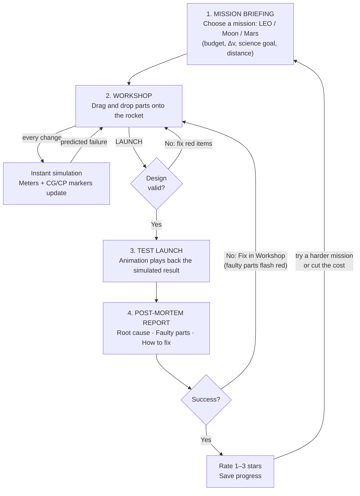
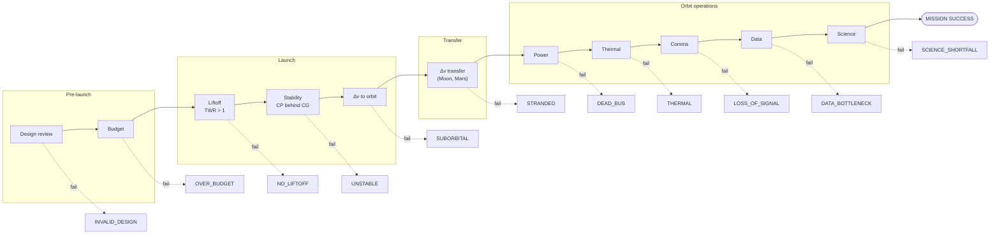
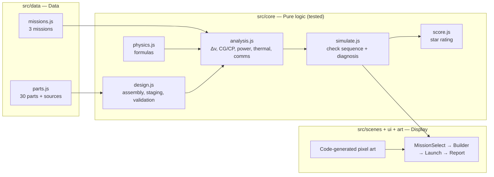

# OrbitCraft 2D — Tutorial

> Challenge: **Space Mission Design Game** — NASA Space Apps Challenge 2026
> Run the game: `npm install` then `npm run dev` (opens http://localhost:8080)
> Vietnamese version: [Tutorial.md](Tutorial.md)

---

## I. Project overview

### 1. The problem

Designing a space mission is a problem of **trade-offs**: every engineering choice sets off a chain of consequences.

- Add one more science instrument and the spacecraft gets heavier, the rocket loses delta-v (Δv), and the spacecraft needs more power.
- Add solar panels to get enough power and you add mass and cost.
- Drop the tail fins to save weight and the rocket becomes unstable and tumbles right after leaving the pad.

The challenge asks for a game in which players **design, manage and simulate** a complete mission themselves. Players must balance 9 factors: mission goals, spacecraft design, science instruments, launch vehicle, budget, power, mass, communications and orbit.

Professional tools such as GMAT are too complex for students and beginners. On the other hand, many "space" games are just quizzes or pre-made animations: players see **success / failure** but never learn **why**.

### 2. The solution

**OrbitCraft 2D** is a lightweight 2D pixel-art web game that runs directly in the browser. Real physics decides every outcome, and the game always explains the cause.

| Key idea | How the game shows it |
| --- | --- |
| **Instant cause and effect** | Every time a part changes, the data panel and the **CG / CP** markers on the rocket update immediately. Players know in advance what will break. |
| **Real physics** | Tsiolkovsky rocket equation for each stage, thrust-to-weight ratio, static stability margin from TIR-33, power balance through the orbit's eclipse, radio range and bandwidth. |
| **Failure post-mortem** | After every flight, the report shows the **root cause**, the **parts at fault** and **how to fix it**. Press *Fix in Workshop* to go back; the faulty parts flash red. |
| **12 different outcomes** | Stuck on the pad, tumble, not enough Δv, stranded in parking orbit, dead bus, thermal failure, loss of signal, data bottleneck, science shortfall, over budget, invalid design, success. |
| **NASA data** | Small spacecraft classes, launcher types and mission scenarios come from NASA documents. Every part names its source (see Part III). |

### 3. Main workflow

#### 3.1 Game loop

#### 3.2 Launch check sequence

The simulator runs its checks **in flight order**. The **first failing check** is the root cause. Later checks are still evaluated and shown in the report as *(predicted)*, so players can fix everything in one go.

#### 3.3 Code architecture

The logic is fully separated from the display, so all of the physics is covered by automated Node tests (`npm test`).

---

## II. How to play

### Step 1 — Choose a mission

| Mission | Destination | Budget | Δv needed | Science goal | Main challenge |
| --- | --- | --- | --- | --- | --- |
| ★ **Eyes on Earth** | Low Earth Orbit, 500 km | $25M | 9,400 m/s | score ≥ 2, needs *imaging* | Getting started: aerodynamic stability |
| ★★ **Lunar Prospector Jr.** | Low Lunar Orbit, 100 km | $40M | 13,400 m/s | score ≥ 4, needs *spectrometer* | Communicating across 384,400 km |
| ★★★ **Red Planet Scout** | Low Mars Orbit, 400 km | $70M | 15,100 m/s | score ≥ 6, needs *imaging* + *spectrometer* | Weak sunlight (43%), Earth is very far |

Click a mission card or press `1` `2` `3`. Each mission opens with a **starter design that has exactly one flaw** for you to find and fix.

### Step 2 — Build in the workshop

The workshop has 3 columns:

| Area | What it does |
| --- | --- |
| **PARTS BIN** (left) | 11 part categories. Hover a part to see its specs and NASA source. |
| **BLUEPRINT** (centre) | The rocket on its launch pad. On the left: the stages (S1, S2…) with their Δv. On the right: the **CG** (yellow) and **CP** (orange) markers and the stability margin. |
| **LIVE ENGINEERING DATA** (right) | One meter per check. Green = pass, yellow = close to the limit, red = will fail. Hover a meter to see the explanation and how to fix it. |

**Controls:**

| To do this | Do this |
| --- | --- |
| Add a part | Drag it from the PARTS BIN onto the rocket (follow the *insert here* line), or click the part |
| Move a part | Drag it on the rocket, or select it and press **UP / DOWN** (keys `↑` `↓`) |
| Remove a part | Drag it to the trash / back to the PARTS BIN, or select it and press **REMOVE** (key `Delete`) |
| Undo / redo | `Ctrl+Z` / `Ctrl+Y` |
| Back to starter design / clear everything | **RESET** / **CLEAR** |
| Open the help | **?** button or key `H` |
| Launch | **LAUNCH** or key `Enter` |

**Assembly rules** (breaking one blocks the launch):

1. The **nose cone** goes on top, and there can only be one.
2. Right below the nose is the **payload bay**: exactly one **Bus** (spacecraft frame), then instruments, batteries, thermal control and radios.
3. The spacecraft mass must not exceed what the Bus can hold: 6U CubeSat ≤ 12 kg, Microsat ≤ 100 kg, Smallsat ≤ 180 kg.
4. Below it are the **rocket stages**, separated by **Stage Decouplers**. Each stage needs an engine and a fuel tank of the same type (chemical, or xenon for the ion engine).

### Step 3 — Read the blueprint and balance the design

| Check | Passes when | If it fails, try… |
| --- | --- | --- |
| **Budget** | Total cost ≤ budget | Swap in cheaper parts, drop what you don't need |
| **Liftoff TWR** | Stage-1 thrust > weight of the whole rocket (≥ 1.2 recommended) | Use a *Booster Engine* or two engines in the bottom stage. The *Vacuum Engine* gives no thrust at sea level. |
| **Stability** | **CP below CG** by at least 1 caliber | Put the **fins at the bottom** of the rocket, or use larger fins |
| **Δv to orbit** | Total stage Δv ≥ requirement | Add fuel or another stage. Remove excess mass. A blunt nose wastes extra Δv. |
| **Δv transfer** | Δv left after reaching orbit ≥ requirement | Add an upper stage. The ion engine is very efficient but has a ×1.75 penalty. |
| **Solar power** | Average power over an orbit ≥ power used | Add solar panels. At Mars sunlight is only 43% as strong. |
| **Battery** | Battery lasts through the eclipse | Use a bigger battery |
| **Thermal** | Thermal level ≥ environment (+1 if the spacecraft uses > 100 W) | MLI for LEO, Radiator for the Moon, Heaters for Mars |
| **Comms** | A radio can reach Earth | UHF only works near Earth. S-band reaches the Moon. X-band reaches Mars. |
| **Data return** | Daily bandwidth ≥ data the instruments produce | A faster radio, or a less data-heavy instrument |
| **Science** | Enough points and the required instrument types | Add a camera / spectrometer |

> 💡 **Domino effect:** add one heavy instrument → the spacecraft gets heavier → Δv drops and it needs more power → it needs more solar panels → heavier and more expensive again. Watch the meters on the right to see this chain.

### Step 4 — Launch and read the report

- During the launch, the HUD shows mission elapsed time, altitude, velocity and current stage, plus a **Flight Log**. Key `S` plays it at 2.5x speed; `Esc` skips straight to the report.
- The **post-mortem report** contains:
  - **ROOT CAUSE**: what broke, explained with physics.
  - **PARTS INVOLVED**: the parts at fault.
  - **HOW TO FIX**: a suggested fix.
  - **FLIGHT CHECKS**: every check. Grey *(predicted)* lines are failures that would have happened next if the flight had gone further.
- Press **FIX IN WORKSHOP** (`Enter`) to go back and fix it. The faulty parts flash red.

### Step 5 — Earn stars

| Star | Condition |
| --- | --- |
| ★ | Mission success |
| ★ | Thrifty: cost ≤ 80% of the budget |
| ★ | Bonus science: score ≥ 1.5 × the goal |

### Example: completing the first mission

1. Choose **Eyes on Earth** and press **LAUNCH** straight away. The rocket **tumbles**.
2. The report says *Aerodynamic tumble — CP is ahead of CG*.
3. **FIX IN WORKSHOP**: open the **Stabilizer Fins** category and drag **Large Fins** to the **bottom** of the rocket. The CP marker (orange) drops below the CG (yellow) and the *Stability* meter turns green.
4. **LAUNCH** again: the rocket reaches orbit, sends its data home, **MISSION SUCCESS**.

The other two missions also have one built-in flaw: the Moon mission **loses signal** and the Mars mission ends with a **dead bus**. Find the fix yourself!

### Keyboard shortcuts

| Screen | Keys |
| --- | --- |
| Mission select | `1` `2` `3` |
| Workshop | `↑` `↓` move · `Delete` remove · `Esc` deselect · `Ctrl+Z` / `Ctrl+Y` · `H` help · `Enter` launch |
| Launch | `S` speed · `Esc` view report |
| Report | `Enter` fix · `R` relaunch · `Esc` back to missions |
| Everywhere | `M` sound on/off |

---

## III. Sources

Every part in [`src/data/parts.js`](src/data/parts.js) has a `source` field that points to an entry in `SOURCES`. The game shows the source name in the info box when you hover a part. Below is exactly what each source contributes.

### 1. NASA Small Spacecraft Technology State-of-the-Art 2024 (SOA 2024)

🔗 https://ntrs.nasa.gov/api/citations/20250000142/downloads/SOA_2024_final.pdf

NASA's annual report on small spacecraft technology. This is the **main source for the whole spacecraft side** (16 parts).

| Contribution | Where it is used in the game |
| --- | --- |
| **Small spacecraft classes**: CubeSat (1U unit = 10 cm), microsatellite 10–100 kg, small satellite 100–180 kg | The 3 **Bus** types and their `maxSpacecraftMass` limits (12 / 100 / 180 kg). The *BUS_OVERLOADED* rule. |
| Specification ranges for **science instruments** (camera, telescope, spectrometer, magnetometer) | Mass, power and data per day of the 4 instruments |
| **Power**: solar panels, Li-ion batteries | Solar Panel 30 W / Array 150 W, 40 Wh / 300 Wh batteries |
| **Communications**: UHF, S-band, X-band | Data rate and range of the 3 radios, used in the *Comms* and *Data* checks |
| **In-space propulsion**: ion engine + xenon | Ion Thruster (high Isp, tiny thrust) and Xenon Tank |

### 2. NASA Venture Class Launch Services (VCLS)

🔗 https://www.nasa.gov/kennedy/launch-services-program/

NASA's program for buying launches on **small launch vehicles** that carry small satellites. This is the **source for the rocket side** (7 parts).

| Contribution | Where it is used in the game |
| --- | --- |
| Scale of a small launcher carrying small satellites (mass, thrust, number of stages) | 3 fuel tanks (3 / 9 / 25 t), 3 chemical engines, Stage Decoupler |
| The difference between **first-stage** engines (high sea-level thrust) and **vacuum** engines (high Isp, unusable at sea level) | The `thrustSL / thrustVac` and `ispSL / ispVac` values. The *Liftoff TWR* check only counts sea-level thrust. |
| Cost level of a small-class launch | Part prices and the budgets of the 3 missions |

### 3. TIR-33: Calculating the Center of Pressure of a Model Rocket

🔗 http://ftp.demec.ufpr.br/foguete/bibliografia/TIR-33%20Calculating%20the%20Center%20of%20Pressure%20of%20a%20Model%20Rocket.pdf

A technical paper on the Barrowman method for finding a rocket's **center of pressure (CP)**. This is the **foundation of the whole aerodynamic stability mechanic** (5 parts: 3 nose cones, 2 fin sets).

| Contribution | Where it is used in the game |
| --- | --- |
| Formula CP = Σ(CNα·X) / Σ(CNα) | `centerOfPressure()` in `physics.js`. Position of the **CP** marker on the blueprint. |
| Nose cone normal force coefficient **CNα = 2**; nose CP position at **46.6%** of length for an **ogive** and **66.6%** for a **cone** | The `aero` values of the 3 nose cones |
| Tail fins pull the CP backwards | The `aero` values of Small / Large Fins |
| **Static stability margin** = (CP − CG) / diameter; CP must be behind CG, ideally ≥ 1 caliber | The *Stability* check and the **UNSTABLE** (tumble) outcome |
| Normal force N = CNα · ½ρv² · α · A, and its limits (small angle of attack, subsonic speed) | `normalForce()`, `airDensity()`. The game only applies the stability check to the early in-atmosphere phase, within the paper's scope. |

### 4. NASA Small Spacecraft Systems Virtual Institute — Thermal Control

🔗 https://www.nasa.gov/smallsat-institute/sst-soa/thermal-control/

The **thermal control** chapter for small spacecraft. Source for the 3 thermal parts and the *Thermal* check.

| Contribution | Where it is used in the game |
| --- | --- |
| **Passive** solutions (MLI blankets, radiators) and **active** ones (heaters, louvers) | MLI Blanket, Radiator Panel, Heaters + Louvers (the heaters use power) |
| Thermal environments differ by orbit | The mission's `thermalSeverity`: LEO 1, Moon 2, Mars 3. A spacecraft using > 100 W needs one more level. |

### 5. NASA General Mission Analysis Tool (GMAT)

🔗 https://github.com/nasa/GMAT

NASA's open-source software for designing and optimising trajectories, from LEO and the Moon (including low-thrust CubeSats) to Mars.

| Contribution | Where it is used in the game |
| --- | --- |
| **Sample mission types**: low Earth orbit, low-thrust CubeSat to the Moon, interplanetary to Mars | The 3 scenarios in [`src/data/missions.js`](src/data/missions.js) |
| Reference for **checking Δv budgets**: ~9.4 km/s to LEO; ~4.0 km/s more to lunar orbit; ~5.7 km/s more to Mars orbit | Each mission's `dvToOrbit` and `dvTransfer` |
| Low-thrust trajectories cost more Δv than impulsive burns | The ×1.75 penalty for the ion engine |

### 6. Background knowledge (no separate citation needed)

| Topic | Where it is used |
| --- | --- |
| **Tsiolkovsky rocket equation** Δv = Isp · g₀ · ln(m₀/m_f) | Δv of each stage, including dropping empty stages and the nose fairing |
| Body constants (radius, μ of Earth, Moon, Mars), Kepler's laws | Orbital period, fraction of time in eclipse `asin(R/(R+h))/π` |
| Inverse-square law for sunlight | Solar panels at Mars (1.52 AU) give only ~43% of their power |

### ⚠️ Note on data reliability

The current values are **placeholders within a plausible range**. Every part is still marked `verified: false`. Before submission, the team must:

1. Check every number against its cited source, correct it if needed, then set `verified: true`.
2. Compare the Δv budgets of the 3 missions with GMAT sample problems.
3. Open the **Resources** section on the challenge page and add any sources the organisers suggest to `SOURCES`.
4. Run `npm run test:simulate` after every data change to make sure all missions can still be solved.
