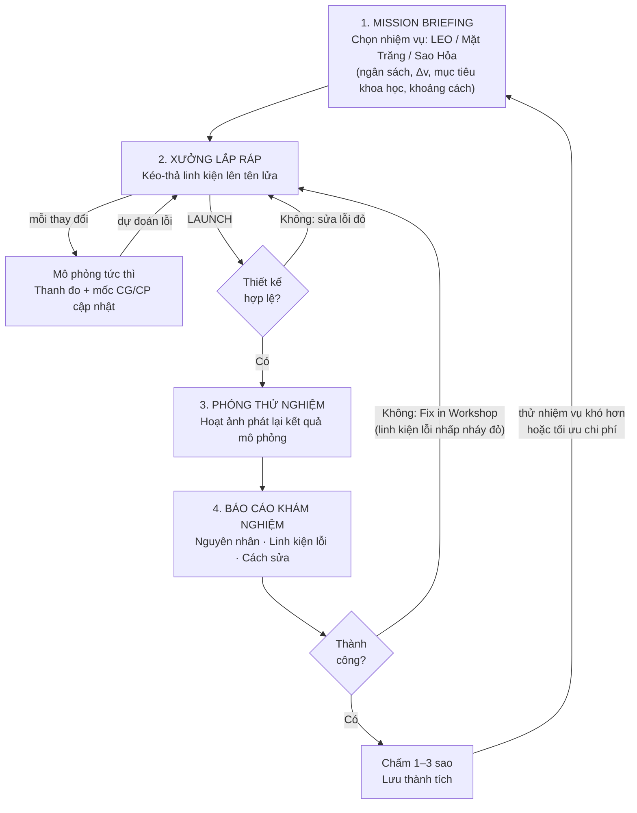
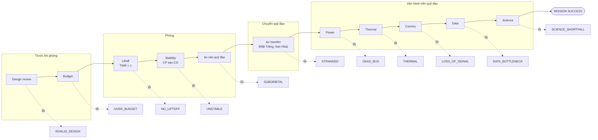
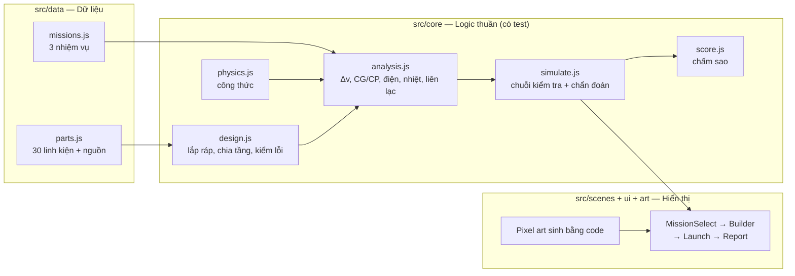

# OrbitCraft 2D — Tutorial

> Thử thách: **Space Mission Design Game** — NASA Space Apps Challenge 2026
> Chạy game: `npm install` rồi `npm run dev` (mở http://localhost:8080)

---

## I. Giới thiệu dự án

### 1. Vấn đề

Thiết kế một sứ mệnh không gian là bài toán **đánh đổi**: mỗi lựa chọn kỹ thuật kéo theo một chuỗi hệ quả.

- Gắn thêm một thiết bị khoa học thì tàu nặng hơn, tên lửa mất bớt Δv và tốn thêm điện.
- Thêm pin mặt trời để đủ điện thì lại tăng khối lượng và chi phí.
- Bỏ cánh đuôi cho nhẹ thì tên lửa mất ổn định và lật nhào ngay sau khi rời bệ phóng.

Đề bài yêu cầu một trò chơi cho người chơi tự **thiết kế, quản lý và mô phỏng** một sứ mệnh hoàn chỉnh. Người chơi phải cân bằng 9 yếu tố: mục tiêu nhiệm vụ, thiết kế tàu, thiết bị khoa học, tên lửa phóng, ngân sách, nguồn điện, khối lượng, liên lạc và quỹ đạo.

Các công cụ chuyên nghiệp như GMAT quá phức tạp với học sinh và người mới. Ngược lại, nhiều game "vũ trụ" chỉ là trắc nghiệm hoặc hoạt ảnh định sẵn: người chơi thấy kết quả **thành công / thất bại** nhưng không hiểu **vì sao**.

### 2. Giải pháp

**OrbitCraft 2D** là một web game 2D pixel-art nhẹ, chạy ngay trên trình duyệt. Mọi kết quả đều do vật lý thật quyết định, và game luôn giải thích nguyên nhân.

| Điểm chính | Cách thể hiện trong game |
| --- | --- |
| **Nhân – quả tức thì** | Mỗi lần đổi linh kiện, bảng số liệu và hai mốc **CG / CP** trên thân tàu cập nhật ngay. Người chơi biết trước điều gì sẽ hỏng. |
| **Vật lý thật** | Phương trình tên lửa Tsiolkovsky cho từng tầng, tỷ lệ lực đẩy / trọng lượng, biên độ ổn định tĩnh theo TIR-33, cân bằng điện qua vùng tối quỹ đạo, tầm phủ sóng và băng thông liên lạc. |
| **Khám nghiệm thất bại** | Sau mỗi chuyến bay, báo cáo chỉ ra **nguyên nhân gốc**, **linh kiện gây lỗi** và **cách sửa**. Bấm *Fix in Workshop* để quay lại xưởng, linh kiện lỗi sẽ nhấp nháy đỏ. |
| **12 kết quả khác nhau** | Kẹt bệ phóng, lật nhào, thiếu Δv, kẹt quỹ đạo đỗ, sập nguồn, hỏng nhiệt, mất tín hiệu, nghẽn dữ liệu, thiếu khoa học, quá ngân sách, thiết kế sai, thành công. |
| **Dữ liệu NASA** | Phân hạng tàu nhỏ, loại tên lửa và kịch bản nhiệm vụ lấy từ tài liệu NASA. Mỗi linh kiện ghi rõ nguồn (xem phần III). |

### 3. Workflow chính

#### 3.1 Vòng chơi

#### 3.2 Chuỗi kiểm tra khi phóng

Bộ mô phỏng chạy các bước kiểm tra **theo đúng thứ tự chuyến bay**. Bước **thất bại đầu tiên** là nguyên nhân gốc. Các bước sau vẫn được tính và hiện trong báo cáo dưới dạng *(predicted)*, để người chơi sửa luôn một lần.

#### 3.3 Kiến trúc mã nguồn

Phần logic tách hẳn khỏi phần hiển thị, nên toàn bộ vật lý được kiểm thử tự động bằng Node (`npm test`).

---

## II. Cách chơi

### Bước 1 — Chọn nhiệm vụ

| Nhiệm vụ | Đích đến | Ngân sách | Δv cần | Yêu cầu khoa học | Thử thách chính |
| --- | --- | --- | --- | --- | --- |
| ★ **Eyes on Earth** | Quỹ đạo thấp 500 km | $25M | 9,400 m/s | điểm ≥ 2, có *imaging* | Làm quen: ổn định khí động học |
| ★★ **Lunar Prospector Jr.** | Quỹ đạo Mặt Trăng 100 km | $40M | 13,400 m/s | điểm ≥ 4, có *spectrometer* | Liên lạc ở 384,400 km |
| ★★★ **Red Planet Scout** | Quỹ đạo Sao Hỏa 400 km | $70M | 15,100 m/s | điểm ≥ 6, có *imaging* + *spectrometer* | Nắng yếu (43%), Trái Đất rất xa |

Bấm vào thẻ nhiệm vụ hoặc phím `1` `2` `3`. Mỗi nhiệm vụ mở ra với một **thiết kế mẫu có đúng một lỗi** để bạn tự tìm và sửa.

### Bước 2 — Lắp ráp trong xưởng

Màn hình xưởng có 3 cột:

| Khu vực | Chức năng |
| --- | --- |
| **PARTS BIN** (trái) | 11 nhóm linh kiện. Rê chuột lên linh kiện để xem thông số và nguồn NASA. |
| **BLUEPRINT** (giữa) | Tên lửa trên bệ phóng. Bên trái là các tầng (S1, S2…) kèm Δv. Bên phải là mốc **CG** (vàng) và **CP** (cam) cùng biên độ ổn định. |
| **LIVE ENGINEERING DATA** (phải) | Thanh đo cho từng bước kiểm tra. Xanh = đạt, vàng = sát ngưỡng, đỏ = sẽ hỏng. Rê chuột lên thanh để xem giải thích và cách sửa. |

**Thao tác:**

| Muốn làm | Cách làm |
| --- | --- |
| Thêm linh kiện | Kéo từ PARTS BIN thả vào tên lửa (theo vạch *insert here*), hoặc bấm vào linh kiện |
| Đổi vị trí | Kéo linh kiện trên thân tàu, hoặc chọn rồi bấm **UP / DOWN** (phím `↑` `↓`) |
| Xóa | Kéo vào thùng rác / về PARTS BIN, hoặc chọn rồi bấm **REMOVE** (phím `Delete`) |
| Hoàn tác / làm lại | `Ctrl+Z` / `Ctrl+Y` |
| Về thiết kế mẫu / xóa hết | **RESET** / **CLEAR** |
| Xem hướng dẫn | Nút **?** hoặc phím `H` |
| Phóng | **LAUNCH** hoặc phím `Enter` |

**Quy tắc lắp ráp** (vi phạm thì không phóng được):

1. **Mũi chụp** nằm trên cùng, chỉ được có một cái.
2. Ngay dưới mũi là **khoang tải trọng**: đúng một **Bus** (khung vệ tinh), rồi đến thiết bị khoa học, pin, tản nhiệt, radio.
3. Khối lượng vệ tinh không vượt sức chứa của Bus: 6U CubeSat ≤ 12 kg, Microsat ≤ 100 kg, Smallsat ≤ 180 kg.
4. Bên dưới là các **tầng tên lửa**, ngăn cách bằng **Stage Decoupler**. Mỗi tầng phải có động cơ và bình nhiên liệu cùng loại (hóa học, hoặc xenon cho động cơ ion).

### Bước 3 — Đọc bản vẽ và cân bằng thiết kế

| Kiểm tra | Điều kiện đạt | Nếu hỏng, thử… |
| --- | --- | --- |
| **Budget** | Tổng chi phí ≤ ngân sách | Thay linh kiện rẻ hơn, bỏ thứ không cần |
| **Liftoff TWR** | Lực đẩy tầng 1 > trọng lượng cả tàu (nên ≥ 1.2) | Dùng *Booster Engine* hoặc 2 động cơ ở tầng dưới. *Vacuum Engine* không có lực đẩy ở mặt đất. |
| **Stability** | **CP nằm dưới CG** ít nhất 1 caliber | Đặt **cánh (fins) ở đáy** tên lửa, hoặc dùng cánh lớn hơn |
| **Δv to orbit** | Tổng Δv các tầng ≥ yêu cầu | Thêm nhiên liệu hoặc thêm tầng. Bớt khối lượng thừa. Mũi tù làm mất thêm Δv. |
| **Δv transfer** | Δv còn dư sau khi vào quỹ đạo ≥ yêu cầu | Thêm tầng trên. Động cơ ion rất tiết kiệm nhưng bị tính phạt ×1.75. |
| **Solar power** | Điện trung bình mỗi vòng ≥ điện tiêu thụ | Thêm pin mặt trời. Ở Sao Hỏa nắng chỉ còn 43%. |
| **Battery** | Pin đủ nuôi tàu qua vùng tối | Dùng pin lớn hơn |
| **Thermal** | Mức tản nhiệt ≥ môi trường (+1 nếu tàu dùng > 100 W) | MLI cho LEO, Radiator cho Mặt Trăng, Heaters cho Sao Hỏa |
| **Comms** | Có radio đủ tầm tới Trái Đất | UHF chỉ dùng được gần Trái Đất. S-band tới được Mặt Trăng. X-band tới được Sao Hỏa. |
| **Data return** | Băng thông/ngày ≥ dữ liệu thiết bị tạo ra | Radio nhanh hơn, hoặc thiết bị ít dữ liệu hơn |
| **Science** | Đủ điểm và đủ loại thiết bị yêu cầu | Thêm camera / spectrometer |

> 💡 **Hiệu ứng domino:** thêm 1 thiết bị nặng → tàu nặng hơn → Δv giảm và cần thêm điện → cần thêm pin mặt trời → lại nặng hơn và đắt hơn. Theo dõi các thanh đo bên phải để thấy chuỗi này.

### Bước 4 — Phóng và đọc báo cáo

- Khi phóng, bảng HUD hiện thời gian bay, độ cao, vận tốc, tầng hiện tại, kèm **Flight Log**. Phím `S` tua nhanh 2.5x, `Esc` bỏ qua để xem báo cáo.
- **Báo cáo khám nghiệm** gồm:
  - **ROOT CAUSE**: điều gì hỏng, giải thích bằng vật lý.
  - **PARTS INVOLVED**: linh kiện gây lỗi.
  - **HOW TO FIX**: gợi ý sửa.
  - **FLIGHT CHECKS**: toàn bộ kiểm tra. Dòng xám *(predicted)* là lỗi sẽ xảy ra tiếp nếu chuyến bay đi xa hơn.
- Bấm **FIX IN WORKSHOP** (`Enter`) để quay lại sửa. Linh kiện lỗi sẽ nhấp nháy đỏ.

### Bước 5 — Kiếm sao

| Sao | Điều kiện |
| --- | --- |
| ★ | Nhiệm vụ thành công |
| ★ | Tiết kiệm: chi phí ≤ 80% ngân sách |
| ★ | Khoa học vượt mức: điểm ≥ 1.5 × yêu cầu |

### Ví dụ: hoàn thành nhiệm vụ đầu tiên

1. Chọn **Eyes on Earth** rồi bấm **LAUNCH** ngay. Tên lửa **lật nhào**.
2. Báo cáo ghi *Aerodynamic tumble — CP is ahead of CG*.
3. **FIX IN WORKSHOP**: mở nhóm **Stabilizer Fins**, kéo **Large Fins** thả xuống **đáy** tên lửa. Mốc CP (cam) tụt xuống dưới CG (vàng), thanh *Stability* chuyển xanh.
4. **LAUNCH** lần nữa: vào quỹ đạo, gửi dữ liệu về, **MISSION SUCCESS**.

Hai nhiệm vụ còn lại cũng có một lỗi cài sẵn: Mặt Trăng bị **mất tín hiệu**, Sao Hỏa bị **sập nguồn**. Hãy tự tìm cách sửa!

### Phím tắt

| Màn hình | Phím |
| --- | --- |
| Chọn nhiệm vụ | `1` `2` `3` |
| Xưởng | `↑` `↓` di chuyển · `Delete` xóa · `Esc` bỏ chọn · `Ctrl+Z` / `Ctrl+Y` · `H` hướng dẫn · `Enter` phóng |
| Phóng | `S` tốc độ · `Esc` xem báo cáo |
| Báo cáo | `Enter` sửa · `R` phóng lại · `Esc` về danh sách nhiệm vụ |
| Mọi nơi | `M` bật/tắt âm thanh |

---

## III. Các nguồn thông tin

Mỗi linh kiện trong [`src/data/parts.js`](src/data/parts.js) có trường `source` trỏ tới một nguồn trong `SOURCES`. Game hiện tên nguồn trong ô thông tin khi rê chuột lên linh kiện. Dưới đây là đóng góp cụ thể của từng nguồn.

### 1. NASA Small Spacecraft Technology State-of-the-Art 2024 (SOA 2024)

🔗 https://ntrs.nasa.gov/api/citations/20250000142/downloads/SOA_2024_final.pdf

Báo cáo thường niên của NASA về công nghệ vệ tinh nhỏ. Đây là **nguồn chính cho toàn bộ phần vệ tinh** (16 linh kiện).

| Đóng góp | Dùng ở đâu trong game |
| --- | --- |
| **Phân hạng vệ tinh nhỏ**: CubeSat (đơn vị 1U = 10 cm), vi vệ tinh 10–100 kg, vệ tinh nhỏ 100–180 kg | 3 loại **Bus** và giới hạn khối lượng `maxSpacecraftMass` (12 / 100 / 180 kg). Quy tắc *BUS_OVERLOADED*. |
| Dải thông số **thiết bị khoa học** (camera, kính thiên văn, spectrometer, magnetometer) | Khối lượng, công suất, lượng dữ liệu/ngày của 4 thiết bị |
| **Nguồn điện**: pin mặt trời, pin Li-ion | Solar Panel 30 W / Array 150 W, pin 40 Wh / 300 Wh |
| **Liên lạc**: UHF, S-band, X-band | Tốc độ truyền và tầm phủ sóng của 3 radio, dùng trong kiểm tra *Comms* và *Data* |
| **Đẩy trong không gian**: động cơ ion + xenon | Ion Thruster (Isp cao, lực đẩy cực nhỏ) và Xenon Tank |

### 2. NASA Venture Class Launch Services (VCLS)

🔗 https://www.nasa.gov/kennedy/launch-services-program/

Chương trình của NASA mua dịch vụ phóng từ các **tên lửa đẩy hạng nhẹ** chuyên chở vệ tinh nhỏ. Đây là **nguồn cho phần tên lửa** (7 linh kiện).

| Đóng góp | Dùng ở đâu trong game |
| --- | --- |
| Quy mô của tên lửa hạng nhẹ chở vệ tinh nhỏ (khối lượng, lực đẩy, số tầng) | 3 bình nhiên liệu (3 / 9 / 25 tấn), 3 động cơ hóa học, Stage Decoupler |
| Khác biệt giữa động cơ **tầng 1** (lực đẩy lớn ở mặt đất) và động cơ **chân không** (Isp cao, không dùng được ở mặt đất) | Thông số `thrustSL / thrustVac`, `ispSL / ispVac`. Kiểm tra *Liftoff TWR* chỉ tính lực đẩy ở mực nước biển. |
| Mức chi phí của một lần phóng hạng nhẹ | Giá linh kiện và ngân sách của 3 nhiệm vụ |

### 3. TIR-33: Calculating the Center of Pressure of a Model Rocket

🔗 http://ftp.demec.ufpr.br/foguete/bibliografia/TIR-33%20Calculating%20the%20Center%20of%20Pressure%20of%20a%20Model%20Rocket.pdf

Tài liệu kỹ thuật về phương pháp Barrowman tính **tâm áp suất (CP)** của tên lửa. Đây là **nền tảng của toàn bộ cơ chế ổn định khí động học** (5 linh kiện: 3 mũi chụp, 2 bộ cánh).

| Đóng góp | Dùng ở đâu trong game |
| --- | --- |
| Công thức CP = Σ(CNα·X) / Σ(CNα) | `centerOfPressure()` trong `physics.js`. Vị trí mốc **CP** trên bản vẽ. |
| Hệ số lực pháp tuyến của mũi chụp **CNα = 2**; vị trí CP của mũi **ogive ở 46.6%**, **mũi nón ở 66.6%** chiều dài | Thông số `aero` của 3 mũi chụp |
| Cánh đuôi kéo CP về phía sau | Thông số `aero` của Small / Large Fins |
| **Biên độ ổn định tĩnh** = (CP − CG) / đường kính; CP phải nằm sau CG, nên ≥ 1 caliber | Kiểm tra *Stability* và kết quả **UNSTABLE** (lật nhào) |
| Lực pháp tuyến N = CNα · ½ρv² · α · A, cùng các giới hạn áp dụng (góc tấn nhỏ, vận tốc cận âm) | `normalForce()`, `airDensity()`. Game chỉ áp dụng bài kiểm tra ổn định cho giai đoạn đầu trong khí quyển, đúng phạm vi của tài liệu. |

### 4. NASA Small Spacecraft Systems Virtual Institute — Thermal Control

🔗 https://www.nasa.gov/smallsat-institute/sst-soa/thermal-control/

Chương về **kiểm soát nhiệt** cho vệ tinh nhỏ. Nguồn cho 3 linh kiện tản nhiệt và kiểm tra *Thermal*.

| Đóng góp | Dùng ở đâu trong game |
| --- | --- |
| Các giải pháp **thụ động** (chăn cách nhiệt MLI, tấm tản nhiệt) và **chủ động** (bộ sưởi, louver) | MLI Blanket, Radiator Panel, Heaters + Louvers (bộ sưởi tiêu tốn điện) |
| Môi trường nhiệt khác nhau theo quỹ đạo | Mức `thermalSeverity` của nhiệm vụ: LEO 1, Mặt Trăng 2, Sao Hỏa 3. Tàu dùng > 100 W cần thêm một mức. |

### 5. NASA General Mission Analysis Tool (GMAT)

🔗 https://github.com/nasa/GMAT

Phần mềm mã nguồn mở của NASA để thiết kế và tối ưu quỹ đạo, từ LEO, Mặt Trăng (gồm cả CubeSat lực đẩy thấp) tới Sao Hỏa.

| Đóng góp | Dùng ở đâu trong game |
| --- | --- |
| Các **loại nhiệm vụ mẫu**: quỹ đạo thấp, CubeSat lực đẩy thấp tới Mặt Trăng, liên hành tinh tới Sao Hỏa | 3 kịch bản trong [`src/data/missions.js`](src/data/missions.js) |
| Cơ sở để **đối chiếu ngân sách Δv**: vào LEO ~9.4 km/s; tới quỹ đạo Mặt Trăng thêm ~4.0 km/s; tới quỹ đạo Sao Hỏa thêm ~5.7 km/s | `dvToOrbit`, `dvTransfer` của mỗi nhiệm vụ |
| Quỹ đạo lực đẩy thấp tốn Δv hơn đốt xung | Hệ số phạt ×1.75 cho động cơ ion |

### 6. Kiến thức nền tảng (không cần trích dẫn riêng)

| Nội dung | Dùng ở đâu |
| --- | --- |
| **Phương trình tên lửa Tsiolkovsky** Δv = Isp · g₀ · ln(m₀/m_f) | Δv từng tầng, có tính việc bỏ tầng rỗng và vỏ chụp mũi |
| Hằng số thiên thể (bán kính, μ của Trái Đất, Mặt Trăng, Sao Hỏa), định luật Kepler | Chu kỳ quỹ đạo, tỷ lệ thời gian trong vùng tối `asin(R/(R+h))/π` |
| Định luật nghịch đảo bình phương của ánh sáng Mặt Trời | Pin mặt trời ở Sao Hỏa (1.52 AU) chỉ còn ~43% công suất |

### ⚠️ Lưu ý về độ tin cậy của số liệu

Các thông số hiện tại là **giá trị giữ chỗ trong khoảng hợp lý**. Mọi linh kiện đang để `verified: false`. Trước khi nộp bài, nhóm cần:

1. Đối chiếu từng số với nguồn đã ghi, sửa nếu cần, rồi đổi thành `verified: true`.
2. So ngân sách Δv của 3 nhiệm vụ với bài toán mẫu trong GMAT.
3. Mở mục **Resources** trên trang thử thách và bổ sung nguồn ban tổ chức gợi ý (nếu có) vào `SOURCES`.
4. Chạy `npm run test:simulate` sau mỗi lần sửa số để chắc các nhiệm vụ vẫn giải được.
